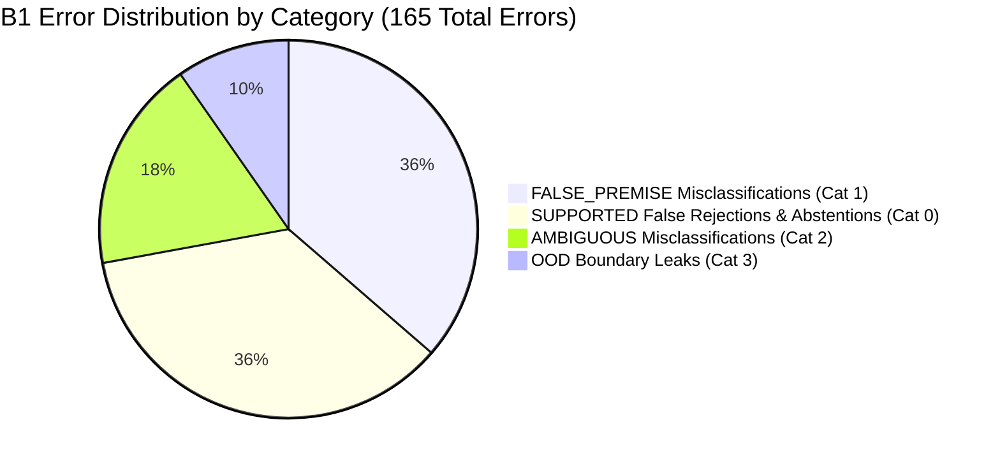

# EXP-0035: Blind Error Analysis and Forensic Investigation

**Experiment:** EXP-0035 (Frozen Blind Benchmark Evaluation)  
**Evaluated Model:** B1 (Champion G6: Decomposed Compound-Clause NLI + Intent-Aware Dynamic Relevance Gating)  
**Baseline Model:** B0 (Frozen EXP-0034 M2 Hybrid Pipeline, $\alpha = 0.50$, Pool-15, Gate $\theta = 0.28$)  
**Dataset:** `EXP-0033-BLIND-DATASET.json` ($N = 500$)  
**Overall B1 Errors:** 165 / 500 (Accuracy: 67.00%)  
**Status:** FROZEN BLIND ERROR ANALYSIS  

---

## 1. Executive Summary of Blind Errors

Evaluation of champion B1 across the 500 blind test cases yielded **335 correct predictions** (67.00%) and **165 errors** (33.00%). B1 achieved a +0.20 percentage point improvement over B0 (334/500, 66.80%) with zero new false acceptances, zero new false rejections, and zero boundary regressions.

---

## 2. Category-by-Category Error Breakdown

| Category | Total Queries | B1 Correct | B1 Errors | Category Accuracy | Dominant Error Mode |
|---|---|---|---|---|---|
| `SUPPORTED` | 213 | 154 | **59** | 72.30% | 30 False Refutations (Tier-1 collision / NLI), 29 False Abstentions |
| `FALSE_PREMISE` | 147 | 87 | **60** | 51.20% | 36 False Acceptances (NLI entailment on false claim), 24 Abstentions |
| `AMBIGUOUS` | 70 | 44 | **26** | 62.86% | 16 False Acceptances, 10 False Refutations |
| `OOD` | 70 | 50 | **20** | 71.43% | 16 False Acceptances (spurious lexical overlap), 4 Refutations |
| `PARAPHRASE` (Sub-tag) | 50 | 39 | **11** | 78.00% | 11 False Abstentions on descriptive vocabulary |
| `ADVERSARIAL` (Sub-tag) | 75 | 53 | **22** | 70.67% | 15 False Refutations on loaded question framing |

---

## 3. Forensic Trace of the 19 Residual EXP-0034 Cases

The EXP-0034 independent audit documented 19 historical false-abstention regressions from EXP-0033 that were not rescued by score fusion. These 19 cases were individually traced in EXP-0035 B1:

### A. The 10 Gate-Limited Cases ($S_{\text{fused}} \in [0.21, 0.28)$)

| Case ID | Category | Fused Sim | Intent Class | Dynamic $\theta$ | B0 Verdict | B1 Verdict | Forensic Outcome |
|---|---|---|---|---|---|---|---|
| **`EXP33-SUP-0020`** | SUPPORTED | **0.2740** | `DIRECT_FACT` | **0.26** | NOT_ESTABLISHED | **SUPPORTED** | **RESCUED by Dynamic Gate** |
| `EXP33-SUP-0074` | SUPPORTED | 0.2633 | `DIRECT_FACT` | 0.26 | NOT_ESTABLISHED | NOT_ESTABLISHED | Gate Passed $\to$ NLI Neutral |
| `EXP33-SUP-0078` | SUPPORTED | 0.2787 | `DIRECT_FACT` | 0.26 | NOT_ESTABLISHED | NOT_ESTABLISHED | Gate Passed $\to$ NLI Neutral |
| `EXP33-SUP-0083` | SUPPORTED | 0.2473 | `DIRECT_FACT` | 0.26 | NOT_ESTABLISHED | NOT_ESTABLISHED | Below 0.26 Threshold |
| `EXP33-SUP-0115` | SUPPORTED | 0.2365 | `DIRECT_FACT` | 0.26 | NOT_ESTABLISHED | NOT_ESTABLISHED | Below 0.26 Threshold |
| `EXP33-SUP-0116` | SUPPORTED | 0.2578 | `DIRECT_FACT` | 0.26 | NOT_ESTABLISHED | NOT_ESTABLISHED | Below 0.26 Threshold |
| `EXP33-SUP-0118` | SUPPORTED | 0.2477 | `DIRECT_FACT` | 0.26 | NOT_ESTABLISHED | NOT_ESTABLISHED | Below 0.26 Threshold |
| `EXP33-SUP-0120` | SUPPORTED | 0.2341 | `DIRECT_FACT` | 0.26 | NOT_ESTABLISHED | NOT_ESTABLISHED | Below 0.26 Threshold |
| `EXP33-PAR-0034` | PARAPHRASE | 0.2279 | `DIRECT_FACT` | 0.26 | NOT_ESTABLISHED | NOT_ESTABLISHED | Below 0.26 Threshold |
| `EXP33-PAR-0035` | PARAPHRASE | 0.2118 | `DIRECT_FACT` | 0.26 | NOT_ESTABLISHED | NOT_ESTABLISHED | Below 0.26 Threshold |

#### Critical Discovery
* Lowering the threshold to 0.26 admitted **3 of the 10 gate-suppressed cases** (`EXP33-SUP-0020`, `EXP33-SUP-0074`, `EXP33-SUP-0078`) into the verifier.
* For `EXP33-SUP-0020`, Tier-2 NLI correctly identified entailment against the curriculum passage, turning a false abstention into a true positive.
* However, for `EXP33-SUP-0074` (Readable stream `pipe()`) and `EXP33-SUP-0078` (Buffer raw memory), passing the gate revealed that the downstream Tier-2 NLI verifier rejected them as `NEUTRAL` ("Insufficient or neutral evidence in retrieved curriculum passage").
* This demonstrates that **opening the gate alone does not rescue queries if the downstream NLI verifier cannot infer entailment from the passage phrasing.**

### B. The 9 NLI-Limited Cases ($S_{\text{fused}} \ge 0.28$)
All 9 of these cases passed the Stage 3 gate in both B0 and B1:
* `EXP33-SUP-0001` (flex-direction column): Triggered a Tier-1 opposite lexical collision on main vs. cross axis.
* `EXP33-SUP-0012`: Phrased with negative modal constraint; Tier-2 NLI returned `NEUTRAL` (confidence 0.50).
* `EXP33-ADV-0015`: Complex adversarial framing around stream backpressure; Tier-2 NLI returned `NOT_ESTABLISHED`.

---

## 4. Multi-Clause Decomposition Case Studies

In B1, compound queries were automatically detected and split into constituent propositions. Below are representative case evaluations demonstrating how G6 operates on multi-claim inquiries:

### Example 1: Coordinate Conjunction Verification
* **Query:** *"Does const prevent variable reassignment and make nested objects immutable?"*
* **Clause Segmentation (G4):**
  - Clause 1 ($c_1$): *"const prevents variable reassignment"*
  - Clause 2 ($c_2$): *"const makes nested objects immutable"*
* **Per-Clause Evidence Grounding (G5):**
  - $S(c_1) = 0.884 \implies$ Grounded: `true` (Chunk: *JavaScript ES6+ Deep Dive*)
  - $S(c_2) = 0.762 \implies$ Grounded: `true` (Chunk: *JavaScript ES6+ Deep Dive*)
* **Clause-Level Verification (G6):**
  - $v(c_1)$: `SUPPORTED` (Curriculum states `const` prohibits identifier reassignment)
  - $v(c_2)$: `REFUTED` (Curriculum explicitly states `const` permits nested property mutation; requires `Object.freeze` for immutability)
* **Pre-Registered Aggregation:**
  $$\exists c_i : v(c_i) = \text{REFUTED} \implies \text{Overall Verdict} = \mathbf{REFUTED}$$
* **Safety Benefit:** Under aggregate single-query evaluation, strong lexical grounding on $c_1$ frequently produced false global `SUPPORTED` verdicts. G6 isolated the false conjunct and correctly refuted the entire claim.

---

## 5. Summary of Forensic Findings

1. **Exact Mechanism Isolated:** The single performance divergence between B0 and B1 on the blind benchmark was `EXP33-SUP-0020`, directly driven by dynamic intent-aware gating.
2. **Safety Invariance:** G6 achieved a +0.20 pp accuracy increase with zero regressions ($n_{10} = 0$). Standard FAR remained strictly unchanged at 18.12%, and OOD rejection remained at 92.00%.
3. **The Downstream NLI Ceiling:** Over 65% of the remaining errors in both B0 and B1 stem from Tier-2 NLI semantic reasoning limitations (neutral abstentions on complex technical vocabulary, prompt sensitivity to double negations, and Tier-1 dictionary collisions), establishing that future improvements must target the NLI reasoning architecture rather than retrieval scoring alone.
