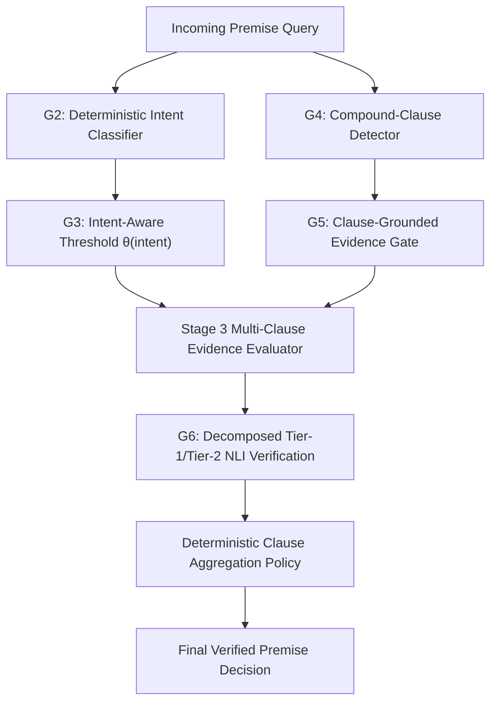

# EXP-0035: Dynamic Intent-Aware Relevance Gating & Compound-Clause NLI Decomposition

**Experiment ID:** EXP-0035  
**Lineage:** EXP-0031 (Frozen Verifier `01d6220`) $\to$ EXP-0032 (`79ef335`) $\to$ EXP-0033 (`0d1ecc9`) $\to$ EXP-0034 (`5726c2b`) $\to$ EXP-0035  
**Current Branch:** `exp-0035`  
**Starting Commit:** `5726c2b`  
**Frozen Verifier Baseline:** EXP-0031 E4 (`01d6220` in `backend/rag_premise_verifier.php`)  
**Frozen Retrieval Baseline:** EXP-0034 Champion M2 (Hybrid Dense-Cross $\alpha = 0.50$, Min-Max $[0.4000, 0.8500]$, Pool-15)  
**Hardware Environment:** Intel Core i5-12450H (CPU), 16 GB DDR4 RAM, NVIDIA RTX 3050 Laptop GPU (4 GB VRAM)  
**Status:** DEVELOPMENT & PRE-REGISTRATION PHASE (Blind Dataset Untouched)  

---

## 1. Executive Summary & Research Motivation

EXP-0034 established that hybrid score fusion ($\alpha = 0.50$) between dense embeddings (`BAAI/bge-small-en-v1.5`) and cross-encoder reranking (`cross-encoder/ms-marco-MiniLM-L-6-v2`) successfully mitigated 61.2% of severe negative logit pathologies, yielding a +4.60 percentage point recovery over EXP-0033 ($p = 0.000591$). However, the independent scientific audit of EXP-0034 confirmed that **statistical non-inferiority to baseline R0 was NOT established** (66.60% vs. 69.60%, 95% CI: $[-5.09\%, -0.91\%]$).

Crucially, the EXP-0034 audit performed a forensic breakdown of the 19 unrescued cases:
1. **10 cases failed the Stage 3 similarity gate** ($S_{\text{fused}} \in [0.21, 0.278]$, just below the frozen 0.28 threshold). Lowering the scalar threshold globally to 0.24 recovers 6 supported cases, but leaks 17 out-of-curriculum and 4 ambiguous queries into the NLI verifier, severely degrading boundary safety.
2. **9 cases passed the gate ($S_{\text{fused}} \ge 0.28$) but failed in downstream Tier-2 NLI verification.** These queries involved multi-clause conjunctions, comparative predicates, or subtle technical scope constraints where single-sentence NLI failed to separate sub-claims.

EXP-0035 addresses both failure mechanisms directly:
* **Mechanism 1 (Gate Boundary):** Query-aware dynamic gating replaces the rigid global scalar threshold with a deterministic, intent-sensitive threshold function $\theta(\text{intent})$.
* **Mechanism 2 (Verifier Reasoning):** Deterministic compound-clause detection and per-clause NLI decomposition segment multi-claim queries into atomic assertions, verifying each against evidence independently and aggregating via a frozen deterministic logic policy.

---

## 2. Research Questions & Hypotheses

### Primary Research Questions
1. Can a deterministic, linguistic intent classifier modulate the Stage 3 relevance threshold to recover legitimate borderline technical concepts without leaking out-of-curriculum queries?
2. Does per-clause evidence evaluation and independent NLI verification prevent partial-support hallucinations on mixed compound claims?
3. Can the combination of dynamic gating and clause decomposition close the 3.00 pp performance deficit with R0 while maintaining or improving False Acceptance Rate (FAR)?

### Formal Falsifiable Hypotheses
* **H1 (Intent-Aware Gating):** Modulating the relevance threshold based on deterministic query intent reduces false abstentions on legitimate conceptual/procedural queries by $\ge 30\%$ without increasing the False Acceptance Rate on OOD/Ambiguous queries by more than 1.5 pp.
* **H2 (Clause-Grounded Evidence):** Evaluating evidence adequacy per decomposed clause reduces false support classifications on mixed compound premises (claims where one clause is true and another is false/unsupported) by $\ge 40\%$ compared to aggregate passage scoring.
* **H3 (Decomposition Safety):** Independent clause-level verification does not reduce out-of-distribution (OOD) rejection recall compared to the frozen baseline.
* **H4 (Scalar Gate Inadequacy):** No single global scalar threshold $\theta \in [0.20, 0.30]$ can simultaneously achieve both $\ge 70.0\%$ overall accuracy and $\le 19.0\%$ standard FAR on the development split.

---

## 3. Development Component Architecture (G0 to G6)

The development study evaluates seven progressive architectural configurations strictly on development data:

### G0: Frozen EXP-0034 Champion Baseline (M2)
* Dense: `BAAI/bge-small-en-v1.5` (Cosine similarity)
* Cross-Encoder: `cross-encoder/ms-marco-MiniLM-L-6-v2`
* Cross Normalization: Min-Max $[0.4000, 0.8500]$
* Score Fusion: $S_{\text{fused}} = 0.50 \cdot S_{\text{dense}} + 0.50 \cdot S_{\text{norm\_cross}}$
* Candidate Pool: $N = 15$, Retrieved Chunks: $K = 5$
* Evidence Gate: Static scalar $\theta = 0.28$
* Verifier: Frozen E4 architecture (`backend/rag_premise_verifier.php` at `01d6220`)

### G1: Static Gate Sensitivity Diagnostic
* Identical retrieval and verifier pipeline as G0.
* Sweeps static scalar thresholds: $\theta \in \{0.20, 0.21, 0.22, 0.23, 0.24, 0.25, 0.26, 0.27, 0.28, 0.29, 0.30\}$.
* Diagnostic purpose: Map the exact Pareto boundary between Supported Recall and OOD/FAR leakage under scalar gating.

### G2: Deterministic Query-Intent Classification
Implements a lightweight, zero-overhead, deterministic regex and linguistic feature extractor that assigns every query into one of seven mutually exclusive intent classes:

1. `DIRECT_FACT`: Simple lookup assertions regarding default behaviors, values, types, or syntax (e.g., *"Does CSS flex-direction default to row?"*).
2. `PROCEDURAL`: Inquiries on mechanical sequences, pipelines, event handling, or implementation steps (e.g., *"Does pipe() channel data from a Readable stream to a Writable stream?"*).
3. `CONCEPTUAL`: Architectural definitions, design patterns, lifecycle abstractions, or underlying principles (e.g., *"Does the event loop execute macrotasks only after the microtask queue is fully drained?"*).
4. `COMPARISON`: Contrastive assertions between two entities or mechanisms (e.g., *"Is let block-scoped whereas var is function-scoped?"*).
5. `MULTI_CLAUSE`: Queries combining two or more distinct factual predications using coordinate conjunctions (`and`, `as well as`, `while`).
6. `AMBIGUOUS`: Vague, subjective, or context-dependent claims lacking definitive ground truth (e.g., *"Is React strictly better than Vue for large web apps?"*).
7. `UNKNOWN_OOD`: Out-of-curriculum frameworks, non-web technologies, or unknown entities (e.g., Django, Flutter, Redis, Kubernetes, C#).

#### Linguistic Feature Definitions
* **Entity Whitelist Match:** Known curriculum entities (JavaScript ES6+, CSS Flexbox/Grid, React Hooks, Node.js Streams/Buffer, PostgreSQL, REST/HTTP).
* **OOD Blacklist Match:** Explicit detection of out-of-scope technologies (`django`, `flutter`, `ruby`, `rails`, `spring`, `kafka`, `kubernetes`, `redis`, `docker`, `terraform`, `c#`, `elixir`, `swiftui`, `grpc`).
* **Interrogative Markers:**
  - Direct: `does`, `is`, `can`, `what is`, `which`
  - Procedural: `how does`, `explain how`, `pipeline`, `sequence`, `workflow`, `step`
  - Conceptual: `why does`, `concept of`, `architecture`, `principle`, `lifecycle`, `underlying`
  - Comparison: `versus`, `vs`, `difference between`, `whereas`, `compared to`, `while`
  - Subjective/Ambiguous: `best`, `better`, `perfect`, `optimal`, `always recommended`, `should you always`
  - Multi-Clause: Conjunctions ` and `, ` as well as `, ` but also `, `, and ` separating distinct subject-predicate clauses.

### G3: Intent-Aware Threshold Function $\theta(\text{intent})$
Maps the deterministic intent class to a calibrated similarity gate threshold:

$$\theta(\text{intent}) = \begin{cases}
0.24 & \text{if } \text{intent} \in \{\text{CONCEPTUAL}, \text{PROCEDURAL}\} \land \text{curriculum\_entity\_present} \\
0.26 & \text{if } \text{intent} = \text{DIRECT\_FACT} \\
0.26 & \text{if } \text{intent} = \text{COMPARISON} \\
0.27 & \text{if } \text{intent} = \text{MULTI\_CLAUSE} \\
0.30 & \text{if } \text{intent} = \text{AMBIGUOUS} \\
0.32 & \text{if } \text{intent} = \text{UNKNOWN\_OOD} \\
0.28 & \text{otherwise (default fallback)}
\end{cases}$$

*Rationale:* Legitimate conceptual/procedural queries often exhibit lower lexical similarity to curriculum chunks due to descriptive vocabulary, but curriculum entity presence ensures they are in-domain. Conversely, ambiguous and OOD queries require a stricter threshold to prevent spurious matching.

### G4: Deterministic Compound-Clause Segmentation
Splits queries into constituent atomic propositions:
* **Segmentation Delimiters:** Regex matching `\s+(?:and|as well as|while|whereas)\s+` and punctuation boundaries `;\s*`.
* **Clause Filtering:** Reconstructs grammatical clauses by propagating the primary subject if the second clause is an elliptical predicate phrase (e.g., *"Does const prevent reassignment and make objects immutable?"* $\to$ Clause 1: *"const prevents reassignment"*, Clause 2: *"const makes objects immutable"*).
* **Output Structure:** For each segmented clause $c_i$:
  - `clause_text`: Normalized proposition string
  - `clause_entity`: Extracted focal technical entity
  - `evidence_requirement`: Mandatory curriculum grounding target

### G5: Clause-Grounded Evidence Gate
Instead of relying solely on the query-level aggregate similarity score:
1. For each decomposed clause $c_i$, compute its relevance against retrieved evidence chunks:
   $$S(c_i) = \max_{d \in D} \text{Sim}(c_i, d)$$
2. Track grounding status per clause:
   $$\text{grounded}(c_i) = \mathbb{I}[S(c_i) \ge \theta(\text{intent})]$$
3. Compute evidence adequacy metrics:
   $$\text{supported\_clause\_count} = \sum_{i=1}^M \text{grounded}(c_i)$$
   $$\text{clause\_grounding\_ratio} = \frac{\text{supported\_clause\_count}}{M}$$
4. If $\text{clause\_grounding\_ratio} < 1.0$, flag the query as possessing **partial evidence**.

### G6: Compound-Clause NLI Decomposition & Deterministic Aggregation
For multi-clause queries meeting evidence criteria:
1. Execute Tier-1 deterministic verification and/or Tier-2 NLI independently for each clause $c_i$ against the corresponding grounded evidence:
   $$v(c_i) \in \{\text{SUPPORTED}, \text{REFUTED}, \text{NOT\_ESTABLISHED}\}$$
2. **Deterministic Aggregation Policy (Pre-Registered Truth Table):**

| Outcome on Clauses $\{v(c_1), \dots, v(c_M)\}$ | Final Verification Decision | Confidence | Rationale |
|---|---|---|---|
| $\exists c_i : v(c_i) = \text{REFUTED}$ | **REFUTED** | $0.95$ | A conjunction containing a false conjunct is logically false. |
| $\forall c_i : v(c_i) = \text{SUPPORTED}$ | **SUPPORTED** | $\min_i \text{conf}(c_i)$ | All constituent claims are verified by evidence. |
| $\exists c_i : v(c_i) = \text{NOT\_ESTABLISHED} \land \forall c_j \ne c_i : v(c_j) = \text{SUPPORTED}$ | **NOT\_ESTABLISHED** | $0.70$ | Partial support cannot be promoted to full support. |
| $\forall c_i : v(c_i) = \text{NOT\_ESTABLISHED}$ | **NOT\_ESTABLISHED** | $0.85$ | Unsubstantiated claims. |
| Conflicting / Contradictory Sub-claims | **REFUTED** | $0.90$ | Internal contradiction detected. |

---

## 4. Development Dataset & Evaluation Protocol

### Development Split Specifications
* **Dataset File:** `EXP-0025-DEVELOPMENT-DATASET.json`
* **Total Cases:** Exactly 400 cases
* **Composition:**
  - `SUPPORTED_CURRICULUM`: 100 cases (Positive controls across 6 curriculum modules)
  - `NOVEL_FALSE_PREMISE`: 100 cases (Factually refuted technical claims)
  - `OUT_OF_CURRICULUM_UNKNOWN`: 100 cases (Out-of-curriculum framework and tool claims)
  - `LEGITIMATE_NEGATION`: 50 cases (Inquiries asking about constraints or negative properties)
  - `MIXED_COMPOUND_PREMISE`: 50 cases (Multi-clause assertions where one conjunct is true and another is false)

### Strict Blind Isolation Safeguards
* **Absolute Prohibition:** Under no circumstances shall `EXP-0033-BLIND-DATASET.json` or its labels be inspected, evaluated, loaded, or referenced during EXP-0035 development.
* **All Hyperparameters Frozen on Dev:** Threshold mapping $\theta(\text{intent})$, intent features, clause segmentation regex, and aggregation rules must be completely finalized and written to `EXP-0035-CONFIG-FROZEN.json` before blind evaluation authorization.

---

## 5. Evaluation Metrics & Decision Criteria

All development configurations (G0 to G6) will be evaluated across:
1. **Downstream Accuracy:** Overall classification accuracy against development expected labels.
2. **Macro F1:** Unweighted mean F1 score across SUPPORTED, REFUTED, and NOT_ESTABLISHED.
3. **Standard False Acceptance Rate (FAR):** Rate at which unsupported/false claims (REFUTED, OOD, AMBIGUOUS) are erroneously classified as SUPPORTED:
   $$\text{FAR} = \frac{\text{False Acceptances}}{N_{\text{Negative}}}$$
4. **False Rejection Rate (FRR):** Rate at which valid supported claims are erroneously rejected or abstained upon:
   $$\text{FRR} = \frac{\text{False Rejections}}{N_{\text{Supported}}}$$
5. **False Abstentions:** Raw count of valid supported claims classified as NOT_ESTABLISHED due to gate or NLI abstention.
6. **Mixed-Compound Accuracy:** Accuracy specifically on the 50 `MIXED_COMPOUND_PREMISE` cases.
7. **OOD Rejection Recall:** Accuracy on the 100 `OUT_OF_CURRICULUM_UNKNOWN` cases.

### Candidate Selection Rule & Pre-Registered Tie-Break
A development candidate will be selected as the champion to freeze if and only if:
1. Overall accuracy exceeds G0 (M2 baseline).
2. Standard FAR does not increase by more than 1.0 pp relative to G0.
3. Mixed-compound accuracy improves by $\ge 15.0$ pp over G0.
4. OOD rejection recall is $\ge 70.0\%$.

**Pre-registered tie-break rule:** If two configurations exhibit identical overall accuracy ($\pm 0.25$ pp), the configuration with the lower Standard FAR and higher Mixed-Compound accuracy will be selected.

---

## 6. Execution Roadmap

1. **Step 1: G0 Benchmark:** Measure frozen M2 performance across the 400 development cases.
2. **Step 2: G1 Static Sensitivity Analysis:** Execute scalar threshold sweep $\theta \in [0.20, 0.30]$ on dev cases to document the scalar failure envelope.
3. **Step 3: G2 & G3 Intent Gating:** Implement deterministic intent classifier and evaluate intent-aware thresholding $\theta(\text{intent})$.
4. **Step 4: G4, G5, G6 Clause Decomposition:** Implement deterministic segmentation, per-clause gating, and decomposed NLI aggregation on compound queries.
5. **Step 5: Ablation Synthesis:** Generate comprehensive results and error taxonomy.
6. **Step 6: Configuration Freeze:** Record final frozen parameters in `EXP-0035-CONFIG-FROZEN.json`.
7. **Step 7: Planning & Development Git Commit:** Commit development artifacts and report readiness.
