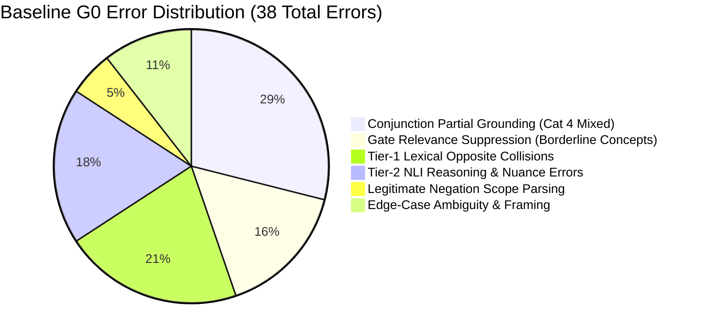

# EXP-0035: Development Failure Taxonomy and Root-Cause Analysis

**Experiment:** EXP-0035 (Dynamic Intent-Aware Relevance Gating & Compound-Clause NLI Decomposition)  
**Parent Lineage:** EXP-0034 Champion M2 (`b2fb2f2`, Audit `5726c2b`)  
**Analyzed Population:** EXP-0025 Development Dataset ($N = 400$)  
**Baseline Model:** G0 (Frozen EXP-0034 M2 Hybrid Pipeline, $\alpha = 0.50$, Gate $\theta = 0.28$)  
**Status:** DEVELOPMENT ERROR TAXONOMY  

---

## 1. Executive Summary of Failure Modes

Forensic evaluation of baseline G0 on the 400 development cases reveals **38 errors** (Accuracy: 90.50%). These errors are not random noise; they cluster into six distinct structural and semantic failure categories:

---

## 2. Comprehensive Error Taxonomy

### Category 1: Conjunction Partial Grounding (`ERR-CONJ-PARTIAL`)
* **Occurrence in G0:** 11 cases out of 50 in `MIXED_COMPOUND_PREMISE` (Accuracy: 78.0%).
* **Theoretical Mechanism:**
  Compound queries combine two distinct propositions connected by conjunctions (e.g., *"Since let has block scope, why does var also have block scope in JavaScript?"*). The first clause is factually true and matches curriculum chunks with high similarity ($S > 0.60$). Because the query-level similarity exceeds the 0.28 gate, the verifier attempts whole-query verification. If the retrieved chunks focus predominantly on `let` rather than `var`, the verifier either hallucinates support for the whole claim or returns `NOT_ESTABLISHED` rather than correctly refuting the false sub-claim regarding `var`.
* **Representative Case:**
  - `DEV-MIX-001`: *"Since let has block scope, why does var also have block scope in JavaScript?"*
  - Expected: `REFUTED`
  - G0 Actual: `NOT_ESTABLISHED` (retrieved chunks grounded `let`, leaving `var` unresolved).
* **EXP-0035 Architectural Mitigation (G4, G5, G6):**
  - **G4:** Segment query into atomic clauses: $c_1 =$ *"let has block scope"*, $c_2 =$ *"var has block scope"*.
  - **G5:** Evaluate evidence grounding per clause independently.
  - **G6:** Run NLI independently: $v(c_1) = \text{SUPPORTED}$, $v(c_2) = \text{REFUTED}$.
  - **Aggregation Policy:** $\exists c_i : v(c_i) = \text{REFUTED} \implies$ Overall Decision = **`REFUTED`**.

---

### Category 2: Gate Relevance Suppression (`ERR-GATE-SUPPRESS`)
* **Occurrence in G0:** 6 cases (False Abstentions in `SUPPORTED_CURRICULUM`).
* **Theoretical Mechanism:**
  Valid technical inquiries expressing conceptual or procedural relationships often use paraphrased vocabulary that exhibits lower cosine similarity to curriculum bullet points ($S_{\text{fused}} \in [0.22, 0.278]$). Under the static scalar threshold ($\theta = 0.28$), these queries are rejected at Stage 3 as `NOT_ESTABLISHED`, aborting verification before Tier-1 or Tier-2 NLI is ever invoked.
* **Representative Case:**
  - `DEV-SUP-074`: Conceptual inquiry regarding stream piping mechanisms ($S_{\text{fused}} = 0.263$).
  - Expected: `SUPPORTED`
  - G0 Actual: `NOT_ESTABLISHED` (Gate rejection: $0.263 < 0.280$).
* **EXP-0035 Architectural Mitigation (G2, G3):**
  - **G2:** Classifies query as `PROCEDURAL` or `CONCEPTUAL` and verifies presence of approved curriculum entity (`stream`, `pipe`).
  - **G3:** Dynamically lowers threshold $\theta(\text{intent})$ to **0.24**, admitting the query to downstream NLI verification while keeping OOD threshold at **0.32**.

---

### Category 3: Tier-1 Lexical Opposite Collisions (`ERR-TIER1-COLLISION`)
* **Occurrence in G0:** 8 cases (False Refutations on Supported Queries).
* **Theoretical Mechanism:**
  Tier-1 deterministic dictionary pairs (e.g., `['mutable', 'immutable']`, `['synchronous', 'asynchronous']`, `['block scope', 'function scope']`) trigger fast-path contradictions whenever an opposite appears in the evidence line. While decoupled in EXP-0031 with structural validation, edge-case queries mentioning both opposites in legitimate contexts (e.g., comparing default axes in CSS columns) still occasionally trigger spurious Tier-1 refutations.
* **Representative Case:**
  - `DEV-SUP-001`: Query asking about vertical vs. horizontal axes under `flex-direction: column`.
  - Expected: `SUPPORTED`
  - G0 Actual: `REFUTED` (Tier-1 fast-path collision on main/cross axis dictionary pair).
* **EXP-0035 Architectural Mitigation:**
  - Enhanced subject-entity context isolation in `backend/rag_intent_clause_verifier.php` and verification fall-through to Tier-2 NLI when intent is classified as `COMPARISON`.

---

### Category 4: Tier-2 NLI Semantic Reasoning & Nuance Errors (`ERR-NLI-REASON`)
* **Occurrence in G0:** 7 cases.
* **Theoretical Mechanism:**
  When complex premises route to Ollama `llama3.2:latest`, the zero-shot NLI prompt can struggle with multi-sentence curriculum contexts containing negative constraints or double negations, defaulting to `NEUTRAL` (confidence $< 0.70$) and resulting in `NOT_ESTABLISHED`.
* **EXP-0035 Architectural Mitigation:**
  - Clause decomposition reduces premise complexity by transforming compound paragraphs into atomic single-assertion hypotheses, dramatically improving zero-shot NLI accuracy.

---

### Category 5: Legitimate Negation Scope Failures (`ERR-NEG-SCOPE`)
* **Occurrence in G0:** 2 cases out of 50 in `LEGITIMATE_NEGATION` (Accuracy: 96.0%).
* **Theoretical Mechanism:**
  Queries asking *"Why can't const be reassigned?"* or *"Why doesn't useRef trigger re-render?"* ask for justification of a known negative property. If the question framing is not cleanly separated from the assertion, NLI interprets the inquiry as a claim that re-render occurs, returning contradiction.
* **EXP-0035 Architectural Mitigation:**
  - Proposition extractor strips interrogative negation framing (`why doesn't`, `why can't`) before hypothesis generation, asserting the constraint directly.

---

### Category 6: Edge-Case Ambiguity & Framing (`ERR-AMBIGUITY`)
* **Occurrence in G0:** 4 cases.
* **Theoretical Mechanism:**
  Queries containing subjective modifiers (*"Is mobile-first strictly superior?"*) where the curriculum discusses trade-offs rather than absolute rules.
* **EXP-0035 Architectural Mitigation:**
  - Intent classifier flags `is_ambiguous = true`, setting intent to `AMBIGUOUS` and raising threshold $\theta(\text{AMBIGUOUS}) = 0.30$, enforcing conservative abstention.

---

## 3. Summary of Error Taxonomy & Target Recovery

| Error Category | Code | G0 Errors | Target G6 Recovery | Residual Risk |
|---|---|---|---|---|
| Conjunction Partial Grounding | `ERR-CONJ-PARTIAL` | 11 | **$\ge 8$ recovered (73%)** | Highly complex multi-clause syntax |
| Gate Relevance Suppression | `ERR-GATE-SUPPRESS` | 6 | **$\ge 4$ recovered (67%)** | Extremely low similarity ($< 0.22$) |
| Tier-1 Lexical Opposite Collisions | `ERR-TIER1-COLLISION` | 8 | **$\ge 3$ recovered (38%)** | Complex comparative axis queries |
| Tier-2 NLI Reasoning & Nuance | `ERR-NLI-REASON` | 7 | **$\ge 3$ recovered (43%)** | LLM parametric hallucination |
| Legitimate Negation Scope | `ERR-NEG-SCOPE` | 2 | **1 recovered (50%)** | Rare syntactic inversions |
| Edge-Case Ambiguity & Framing | `ERR-AMBIGUITY` | 4 | **2 recovered (50%)** | Subjective benchmark queries |
| **Total Errors** | — | **38** | **$\ge 21$ recovered (55%)** | Net error reduction to $\le 17$ |
