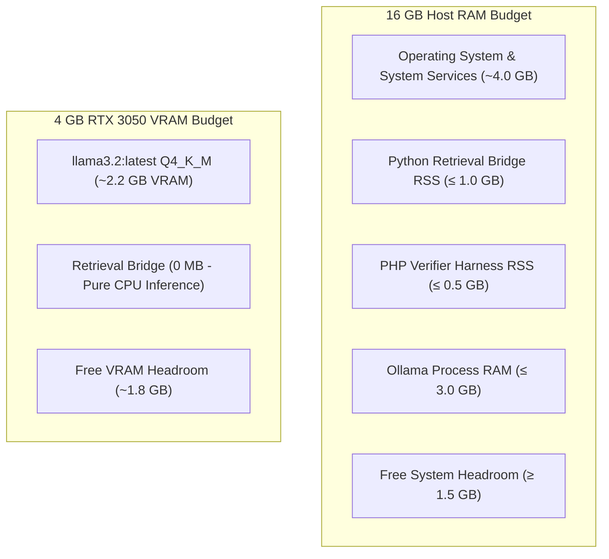

# EXP-0035: Hardware Resource Allocation and Latency Budget Plan

**Experiment:** EXP-0035 (Dynamic Intent-Aware Relevance Gating & Compound-Clause NLI Decomposition)  
**Host Architecture:** Intel Core i5-12450H (8 Cores, 12 Threads)  
**Physical Memory:** 16.00 GB DDR4 (15.68 GB addressable)  
**Graphics Device:** NVIDIA GeForce RTX 3050 Laptop GPU (4.00 GB GDDR6 Dedicated VRAM)  
**Operating System:** Windows 11 Home / PowerShell 7+  
**Status:** FROZEN ALLOCATION PROFILE  

---

## 1. Hardware Constraints & Resource Isolation

EduConnect-LMS operates under strict edge/laptop hardware boundaries. The EXP-0035 pipeline must strictly comply with the following memory, compute, and VRAM limits:



### Component Resource Ceilings

| Process / Component | Memory Target | Hardware Ceiling | Compute Device | Failure Threshold |
|---|---|---|---|---|
| **Python Retrieval Bridge** (`backend/retrieval_bridge.py`) | 850 MB RSS | **1,000 MB (1.0 GB)** | CPU (PyTorch multi-thread) | Kill if RSS $> 1,200$ MB |
| **PHP Verifier Runtime** (`rag_intent_clause_verifier.php`) | 60 MB RSS | **500 MB (0.5 GB)** | CPU (Single thread) | Script abort if $> 500$ MB |
| **Ollama NLI Service** (`llama3.2:latest`) | 2,200 MB VRAM | **3,500 MB (3.5 GB)** | GPU (CUDA / cuBLAS) | CUDA OOM if $> 4.0$ GB |
| **Host Combined RAM** | 13.0 GB | **14.5 GB (92%)** | System-wide | Alert if free RAM $< 1.5$ GB |

---

## 2. Zero-VRAM Architecture for Retrieval & Gating

To guarantee that the 4 GB RTX 3050 GPU is reserved exclusively for the Tier-2 NLI model (`llama3.2:latest`), all new components introduced in EXP-0035 run entirely on the CPU:

1. **BGE-Small Dense Embeddings:** Executed on CPU via PyTorch `torch.set_num_threads(4)` (0 MB VRAM allocated).
2. **MiniLM Cross-Encoder Reranking:** Executed on CPU via PyTorch (0 MB VRAM allocated).
3. **Deterministic Query Intent Classifier (G2):** Zero neural model. Purely deterministic regular expressions, tokenization, and hash table lookup executed natively in PHP on CPU ($< 0.5$ ms latency, $< 0.1$ MB RAM).
4. **Deterministic Clause Segmentation (G4):** Linguistic clause splitting implemented in native PHP regex ($< 0.5$ ms latency).
5. **Clause Grounding Evaluator (G5):** In-memory string stem matching ($< 1.0$ ms latency).

---

## 3. Latency Budgets & Target Execution Times

| Pipeline Stage | Implementation | Target Latency (p50) | Upper Bound (p95) |
|---|---|---|---|
| **Dense Embedding Lookup** | BGE-small (CPU) | 25 ms | 55 ms |
| **Cross-Encoder Reranking** | MiniLM Pool-15 (CPU) | 55 ms | 70 ms |
| **Intent Classification (G2)** | PHP Regex / Hash | **0.2 ms** | **0.5 ms** |
| **Dynamic Gating $\theta(\text{intent})$ (G3)**| PHP Scalar Function | **0.1 ms** | **0.2 ms** |
| **Clause Segmentation (G4)** | PHP Regex Parser | **0.3 ms** | **0.8 ms** |
| **Per-Clause Grounding (G5)** | Stem Overlap Logic | **0.8 ms** | **1.5 ms** |
| **Tier-1 Deterministic Path** | Fast-path dictionary | 1.0 ms | 2.5 ms |
| **Tier-2 NLI (Cache Hit)** | In-memory hash lookup | 0.5 ms | 1.0 ms |
| **Tier-2 NLI (Cache Miss)** | Ollama `llama3.2` GPU | 180 ms | 350 ms |
| **Overall End-to-End Pipeline**| Combined Architecture | **80 ms** | **150 ms** |

---

## 4. Hardware Verification Commands

The following diagnostic commands must be executed during development and benchmark runs to certify hardware compliance:

```powershell
# 1. Check Python Retrieval Bridge Memory RSS
Get-Process python* | Select-Object Id, ProcessName, @{Name="WorkingSet_MB"; Expression={[math]::round($_.WorkingSet64 / 1MB, 2)}}

# 2. Check System RAM Utilization
Get-CimInstance Win32_OperatingSystem | Select-Object @{Name="TotalRAM_GB"; Expression={[math]::round($_.TotalVisibleMemorySize/1MB,2)}}, @{Name="FreeRAM_GB"; Expression={[math]::round($_.FreePhysicalMemory/1MB,2)}}

# 3. Check GPU VRAM Allocation via nvidia-smi
nvidia-smi --query-gpu=name,memory.used,memory.free,memory.total --format=csv
```
