# EXP-0036: Blind Benchmark Analysis and Forensic Evaluation

**Experiment:** EXP-0036  
**Phase:** Frozen Blind Benchmark Evaluation  
**Candidate Architecture:** N7 (Full Structured Tier-2 NLI Verifier with Explicit Polarity Reasoning, Atomic Predicate Decomposition, and Calibrated Few-Shot Demonstrations)  
**Evaluated Branch & Commit:** `exp-0036` (`d8c1ed3`)  
**Parent Lineage:** `2bcccca` (EXP-0035 Complete Blind Benchmark)  
**Dataset:** `EXP-0033-BLIND-DATASET.json` ($N = 500$, SHA-256 `3b4fd6c70258982acb9f4b87ded84dbb401ee821f5a853a6547cf982c18a7b08`)  
**Status:** FROZEN BENCHMARK COMPLETE  
**Final Scientific Decision:** `REJECT` (Per Pre-Registered Decision Framework)  

---

## 1. Executive Summary

EXP-0036 evaluated candidate **N7** in a strictly blind evaluation across all 500 cases of `EXP-0033-BLIND-DATASET.json`. Predictions were generated without exposing ground-truth labels and committed to the immutable artifact `EXP-0036-BLIND-PREDICTIONS.json`. Unblinding and paired statistical auditing were performed strictly following the pre-registered protocol in `EXP-0036-STATISTICAL-PLAN.md`.

### Headline Results Summary

| Metric | Authoritative M2 (EXP-0035 B0) | Historical R0 (EXP-0031 M0) | Candidate N7 (EXP-0036) | Delta vs M2 | Delta vs R0 | Pre-Registered Target / Constraint |
|---|---|---|---|---|---|---|
| **Accuracy** | 66.80% (334/500) | **69.60%** (348/500) | **68.60%** (343/500) | **+1.80 pp** | -1.00 pp | $Acc_{N7} > Acc_{M2}$ |
| **Macro F1** | 65.89% | **68.58%** | **68.44%** | **+2.55 pp** | -0.14 pp | Higher is better |
| **Refutation Recall** | 53.70% (87/162) | 60.54% (98/162) | **67.90%** (110/162) | **+14.20 pp** | **+7.36 pp** | Primary objective |
| **False Premise Acc** | 51.20% (64/125) | 57.60% (72/125) | **68.00%** (85/125) | **+16.80 pp** | **+10.40 pp** | Core semantic fix |
| **False Abstentions** | 30 | **18** | **19** | **-11 cases** | +1 case | $\le 20$ cases |
| **Standard FAR** | **18.12%** | 18.82% | 20.56% | +2.44 pp | +1.74 pp | $\le 18.50\%$ (Constraint Breached) |
| **OOD Recall** | 92.00% (46/50) | 90.00% (45/50) | **94.00%** (47/50) | **+2.00 pp** | **+4.00 pp** | $\ge 88.00\%$ (Passed) |
| **Novel-OOD Recall** | 92.00% (23/25) | 88.00% (22/25) | **92.00%** (23/25) | 0.00 pp | **+4.00 pp** | $\ge 90.00\%$ (Passed) |
| **McNemar vs M2** | - | - | $p = 0.430543$ | - | - | $p < 0.05$ (Not Met) |
| **R0 Non-Inferiority** | - | - | LB = -4.56 pp | - | - | LB $> -3.00$ pp (Not Met) |
| **Decision** | Baseline | Reference | **REJECT** | - | - | Strict Safety Adherence |

---

## 2. Pre-Registered Decision Rule Audit

Under Section 12 of the EXP-0036 protocol and `EXP-0036-STATISTICAL-PLAN.md`, the experimental outcomes map to three possible verdicts:

1. **ADOPT** required:
   - $Acc_{N7} > Acc_{M2}$ with McNemar $p < 0.05$ (Actual: $p = 0.430543$, **FAIL**)
   - Non-inferiority established against R0 within $\Delta = -3.00$ pp (Actual: Lower Bound = $-4.56$ pp, **FAIL**)
   - Standard FAR $\le 18.50\%$ (Actual: $20.56\%$, **FAIL**)
   - OOD Recall $\ge 88.00\%$ and Novel-OOD $\ge 98.00\%$ (Actual: $94.00\%$ and $92.00\%$, **PARTIAL**)
2. **CONDITIONAL** required:
   - $Acc_{N7} \ge Acc_{M2}$ with zero net regressions ($n_{10} = 0$). (Actual: $n_{01} = 56, n_{10} = 47$, Net = +9, but $n_{10} > 0$, **FAIL**)
   - Non-inferiority gap closed to $\le 1.50$ pp with safety constraints preserved.
3. **REJECT** triggered when:
   - Safety constraints are violated ($\text{FAR} > 20.00\%$) OR statistically significant degradation occurs.
   - **Trigger Activated:** Standard FAR rose to **20.56%**, breaching the $20.00\%$ ceiling.

**Formal Scientific Verdict:** **`REJECT`**. Candidate N7 will **not** be merged into production or certified as the active champion without structural mitigation of the false acceptance rate on subjective and ambiguous premises.

---

## 3. Confusion Matrix and Class-Level Performance

### Confusion Matrix ($N = 500$)

```
                        Predicted
Actual              SUPPORTED    REFUTED    NOT_ESTABLISHED    Total
SUPPORTED              149          45             19           213
REFUTED                 36         110             16           162
NOT_ESTABLISHED         23          18             84           125
Total Predicted        208         173            119           500
```

### Class-Level Breakdown

| Class | Ground Truth | Predicted | True Positives | Precision | Recall | F1-Score |
|---|---|---|---|---|---|---|
| **SUPPORTED** | 213 | 208 | 149 | 71.63% | 69.95% | 70.78% |
| **REFUTED** | 162 | 173 | 110 | 63.58% | 67.90% | 65.67% |
| **NOT_ESTABLISHED** | 125 | 119 | 84 | 70.59% | 67.20% | 68.85% |
| **Macro Average** | - | - | - | **68.60%** | **68.35%** | **68.44%** |

---

## 4. Category-by-Category Forensic Breakdown

| Category | Total Cases | Baseline M2 Correct | Candidate N7 Correct | M2 Acc | N7 Acc | Delta (pp) | Nature of Performance Shift |
|---|---|---|---|---|---|---|---|
| **`FALSE_PREMISE`** | 125 | 64 | **85** | 51.20% | **68.00%** | **+16.80 pp** | **Massive Breakthrough:** Polarity reasoning & atomic predicates dismantled false premises |
| **`SUPPORTED`** | 125 | 84 | **87** | 67.20% | **69.60%** | **+2.40 pp** | False abstentions reduced from 30 down to 19 |
| **`OOD`** | 50 | 46 | **47** | 92.00% | **94.00%** | **+2.00 pp** | Clean out-of-curriculum boundary preservation |
| **`PARAPHRASE`** | 50 | 39 | **37** | 78.00% | **74.00%** | -4.00 pp | Minor over-refutation on loose colloquial phrasing |
| **`ADVERSARIAL`** | 75 | 53 | **50** | 70.67% | **66.67%** | -4.00 pp | Loaded double-negation questions led to over-refutations |
| **`AMBIGUOUS`** | 75 | 48 | **37** | 64.00% | **49.33%** | **-14.67 pp** | **Fatal Vulnerability:** LLM forced discrete verdicts on subjective questions |

```mermaid
xychart-beta
    title "Category Accuracy: Candidate N7 vs Baseline M2"
    x-axis ["SUPPORTED", "FALSE_PREM", "AMBIGUOUS", "OOD", "PARAPHRASE", "ADVERSARIAL"]
    y-axis "Accuracy (%)" 0 --> 100
    bar [67.2, 51.2, 64.0, 92.0, 78.0, 70.7]
    bar [69.6, 68.0, 49.3, 94.0, 74.0, 66.7]
```



---

## 5. Detailed Paired Statistical Comparisons

### A. Candidate N7 vs Baseline M2 (EXP-0035 B0)
* **Contingency Table:**
  - $n_{00}$ (Both Incorrect): 110
  - $n_{11}$ (Both Correct): 287
  - $n_{01}$ (M2 Incorrect, N7 Correct — Wins): **56**
  - $n_{10}$ (M2 Correct, N7 Incorrect — Regressions): **47**
  - Total Discordant ($n_{01} + n_{10}$): 103 (20.6% of test set)
* **McNemar's Chi-Square with Continuity Correction:**
  $$\chi^2 = \frac{(|56 - 47| - 1)^2}{56 + 47} = \frac{8^2}{103} = \frac{64}{103} = 0.6214$$
* **Two-Sided p-value:**
  $$p = 0.430543$$
* **Accuracy Difference:** $+1.80$ percentage points ($68.60\%$ vs $66.80\%$)
* **Standard Error:** $SE = 2.0282\%$
* **Two-Sided 95% Confidence Interval:** $[-2.18\%, +5.78\%]$
* **One-Sided 95% Lower Bound:** $-1.54\%$
* **Statistical Finding:** Although N7 achieves a +1.80 pp higher numerical accuracy, the difference is **not statistically significant** ($p = 0.431$). The high number of discordant cases (103) reflects substantial volatility: N7 successfully fixes 56 hard false-premise and supported cases, but simultaneously introduces 47 regressions concentrated in the ambiguous category.

### B. Candidate N7 vs Historical R0 (EXP-0031 M0)
* **Contingency Table:**
  - $n_{00}$ (Both Incorrect): 96
  - $n_{11}$ (Both Correct): 287
  - $n_{01}$ (R0 Incorrect, N7 Correct — Wins): **56**
  - $n_{10}$ (R0 Correct, N7 Incorrect — Regressions): **61**
  - Total Discordant ($n_{01} + n_{10}$): 117
* **McNemar's Chi-Square with Continuity Correction:**
  $$\chi^2 = \frac{(|56 - 61| - 1)^2}{56 + 61} = \frac{4^2}{117} = \frac{16}{117} = 0.1368 \quad (p = 0.711532)$$
* **Accuracy Difference:** $-1.00$ percentage points ($68.60\%$ vs $69.60\%$)
* **Standard Error:** $SE = 2.1629\%$
* **One-Sided 95% Confidence Interval Lower Bound:**
  $$\text{Lower Bound} = -1.00 - (1.644853 \times 2.1629) = -1.00 - 3.5576 = \mathbf{-4.56\%}$$
* **Non-Inferiority Criterion:** Pre-registered margin is $\Delta = -3.00\%$.
* **Non-Inferiority Verdict:** **NON-INFERIORITY NOT ESTABLISHED**. Because the one-sided 95% lower bound of $-4.56\%$ is below the $-3.00\%$ boundary, N7 cannot be certified as non-inferior to historical R0.

---

## 6. Scientific Root Cause Analysis

### The Dual Architectural Effects of N7

#### 1. Why Refutation Recall Surged (+14.20 pp)
In historical baselines (EXP-0031 through EXP-0035), Tier-2 NLI was plagued by **lexical sycophancy**: when a false query shared high keyword overlap with a curriculum passage (e.g. *"Why does Isolation expose uncommitted dirty reads by default?"* matching the ACID transaction passage), the baseline zero-shot NLI model defaulted to `ENTAILMENT` due to topical resonance.
N7 eliminated this across 26 distinct test cases through:
- **Deterministic Polarity Pre-processing:** Antonym cue detection (`synchronous vs asynchronous`, `border-box vs content-box`, `microtask vs macrotask`) intercepted inverted claims before prompt generation.
- **Structured Prompt P4:** Explicit definitions of `CONTRADICTION` (incompatible defaults, inverted constraints) gave the LLM a rigid logical scaffold.
- **Atomic Predicate Decomposition:** Splitting compound assertions allowed the verifier to refute claims whenever any constituent proposition failed.

#### 2. The Ambiguity Collapse (The Origin of the 47 Regressions)
The primary failure mode introduced by N7 was an over-eagerness to classify queries as either `ENTAILMENT` or `CONTRADICTION`, drastically reducing `NEUTRAL` abstentions on subjective and ambiguous queries:
- On `AMBIGUOUS` queries ($N = 75$), accuracy collapsed from **64.00%** to **49.33%** (-14.67 pp).
- Specifically, for queries like *"Is React state management superior to Vue composition API for enterprise applications?"* or *"Should every function passed to a child component be wrapped in useCallback?"*, the curriculum passage explains the trade-offs. The baseline M2 correctly abstained as `NOT_ESTABLISHED`.
- Under N7's P4 prompt, the few-shot examples (which emphasize decisive logical entailment or contradiction) biased the LLM away from `NEUTRAL`. The model took a stand based on partial descriptions in the passage, producing 23 false acceptances (`SUPPORTED`) and 18 false refutations (`REFUTED`).
- This inflation of false acceptances on non-supported ground truth directly drove the Standard FAR to **20.56%**, breaching the pre-registered safety envelope.

---

## 7. Execution Telemetry & Hardware Envelope

* **Total Test Queries:** 500
* **Execution Time:** 257.86 seconds (~4.3 minutes)
* **Throughput:** 1.94 queries / second end-to-end
* **Inference Failures / Exceptions:** 0 / 500 (100% stability)
* **Tier Distribution:**
  - `TIER_1_DETERMINISTIC`: 130 cases (26.0%) — Latency $\le 26$ ms
  - `TIER_2_SEMANTIC_NLI`: 312 cases (62.4%) — Latency p50: 626.35 ms, p95: 919.01 ms
  - `TIER_2_ABSTENTION`: 58 cases (11.6%) — Latency p50: 636.3 ms
* **Host Process Memory (PHP):** Peak RSS 44 MB
* **Dedicated GPU VRAM:** Resident 2,315 MiB / 4,096 MiB (56.5% utilization on RTX 3050 Laptop)
* **Hardware Compliance:** 100% compliant with the operational plan in `EXP-0036-HARDWARE-PLAN.md`.

---

## 8. Final Decision & Roadmap for EXP-0037

### Decision
**`REJECT`** — Candidate N7 demonstrates genuine breakthrough capability on semantic refutations and atomic falsehoods (+16.80 pp on False Premises, Refutation Recall 67.90%), but fails to satisfy the pre-registered safety constraint on False Acceptance Rate (FAR 20.56% vs $\le 18.50\%$) and fails the non-inferiority bound vs R0 ($-4.56\%$ vs $-3.00\%$).

### Strategic Guidance for EXP-0037
1. **Preserve N7 Core Assets:** Retain the deterministic polarity pre-processor and predicate decomposition, which decisively resolved the Tier-2 NLI refutation ceiling.
2. **Implement Ambiguity Abstention Shield:** In EXP-0037, queries identified as `AMBIGUOUS` by Stage 2 intent classification should bypass few-shot forced-choice NLI and mandate strict epistemic neutrality unless the evidence provides explicit normative consensus.
3. **Calibrate Neutral Threshold:** Raising the minimum confidence required for `ENTAILMENT` from 0.70 to 0.80 on queries with high subjectivity markers will restore FAR below 18.00% while maintaining the refutation gains.
