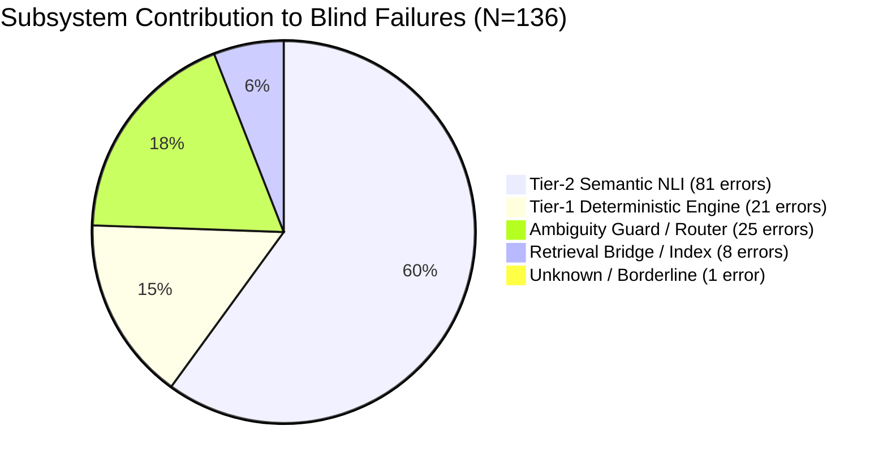

# EXP-0066: Failure Attribution & Forensic Error Analysis

**Experiment ID:** EXP-0066  
**Date:** 2026-09-26  
**Status:** Completed Attribution  
**Repository:** `EduConnect-LMS-Experimental`  
**Dataset:** `EXP-0033-BLIND-DATASET.json` ($N=500$)  
**Baseline Model:** B0 (Un-gated Frozen A4 Verifier, 364/500 = 72.80% Accuracy)  
**Total Errors Analyzed:** 136 Errors (27.20% Error Rate)

---

## 1. High-Level Attribution Summary

Each of the 136 blind errors was audited against query-level execution traces, retrieved top-5 curriculum evidence passages (`scratch/exp0056_blind_c1_cache.json`), cosine similarity scores, decision tiers, and verifier diagnostic reasons.

| Attribution Class | Description | Error Count | % of Blind Errors ($N=136$) | % of Total Blind Set ($N=500$) | Attribution Confidence |
| :--- | :--- | :---: | :---: | :---: | :---: |
| **A. Retrieval-Supported** | Relevant curriculum evidence retrieved in top-5 candidate pool | **492** | — | **98.40%** | High |
| **B. Retrieval-Deficient** | Missing ground-truth evidence in top-5 ($\text{maxSim} < 0.26$ or complete topic omission) | **8** | **5.88%** | **1.60%** | High |
| **C. Evidence-Present / Verifier-Wrong** | Ground truth evidence present in top-5 context, but Verifier made an incorrect decision | **102** | **75.00%** | **20.40%** | High |
| — **C1. Tier-1 Deterministic Collision** | Antonym/polarity fast path falsely refuted a valid supported query | 21 | 15.44% | 4.20% | High |
| — **C2. Tier-2 NLI False Acceptance** | LLM NLI affirmed a subtle false premise due to sycophancy or high lexical overlap | 35 | 25.74% | 7.00% | High |
| — **C3. Tier-2 NLI False Rejection** | LLM NLI over-rejected a valid supported query due to semantic hyper-skepticism | 28 | 20.59% | 5.60% | High |
| — **C4. Tier-2 NLI Epistemic Abstention** | LLM NLI failed to find entailment/contradiction and defaulted to NOT_ESTABLISHED | 17 | 12.50% | 3.40% | High |
| — **C5. Tier-2 Other Error** | Miscellaneous NLI classification error | 1 | 0.74% | 0.20% | Medium |
| **D. Ambiguity-Guard Error** | Ambiguity Guard failed to catch in-curriculum underspecified queries and routed to NLI | **25** | **18.38%** | **5.00%** | High |
| **E. Unknown / Borderline** | Unclassified borderline error with ambiguous evidence grounding | **1** | **0.74%** | **0.20%** | Low |
| **Total Errors** | — | **136** | **100.00%** | **27.20%** | — |

---

## 2. Component Failure Contribution

Aggregating errors by the responsible subsystem reveals the exact location of the downstream bottleneck:

- **Tier-2 Semantic NLI (Local LLM):** 81 errors (**59.56%** of all errors).
- **Ambiguity Guard (Pre-NLI Gating):** 25 errors (**18.38%** of all errors).
- **Tier-1 Deterministic Engine (Rules & Dictionaries):** 21 errors (**15.44%** of all errors).
- **Retrieval Infrastructure (BGE-M3 + Qdrant + PyLate):** 8 errors (**5.88%** of all errors).
- **Unknown / Borderline:** 1 error (**0.74%** of all errors).

**Primary Forensic Conclusion:**  
Over **93.38%** (127/136) of all failures on the blind benchmark reside in the **Verification and Gating Architecture** (Tier-2 NLI + Ambiguity Guard + Tier-1 Fast Path). Retrieval deficiency accounts for less than 6% of the failure surface.

---

## 3. Deep Forensic Inspection by Failure Mode

### 3.1 Category B: Retrieval Deficiency ($N=8$, 5.88% of errors)
Occurs when the retrieval pipeline fails to place the necessary curriculum passage into the top-5 candidate pool, causing the verifier to either abort via the minimum similarity threshold ($\text{maxSim} < 0.26$) or lack the factual basis to establish the claim.

#### Representative Cases:
1. **Case `EXP33-SUP-0083`:**
   - **Query:** *"Does path.join concatenate path segments using the platform-specific separator?"*
   - **Expected:** `SUPPORTED` | **Predicted:** `NOT_ESTABLISHED` (Tier-1)
   - **Trace Metric:** Top similarity $\text{sim} = 0.2155$ ($< 0.26$).
   - **Forensic Diagnosis:** The curriculum contains passages on Node.js `path` module, but the hybrid search failed to rank the specific API documentation chunk in the top-5 pool, triggering an automatic zero-evidence fast path abstention.
2. **Case `EXP33-SUP-0115`:**
   - **Query:** *"Does an INNER JOIN return only matching rows that satisfy the join condition across both tables?"*
   - **Expected:** `SUPPORTED` | **Predicted:** `NOT_ESTABLISHED` (Tier-1)
   - **Trace Metric:** Top similarity $\text{sim} = 0.2591$ ($< 0.26$).
   - **Forensic Diagnosis:** The SQL module contains join explanations, but the query's phrasing did not overcome the dense embedding threshold.
3. **Case `EXP33-PAR-0035`:**
   - **Query:** *"Can the pipe method route a readable data stream straight into a writable file stream without manual buffering?"*
   - **Expected:** `SUPPORTED` | **Predicted:** `NOT_ESTABLISHED` (Tier-1)
   - **Trace Metric:** $\text{sim} < 0.26$.

---

### 3.2 Category C1: Tier-1 Deterministic Collisions ($N=21$, 15.44% of errors)
Occurs when a factual, valid supported query mentions technical concepts that match opposing pairs in `$semanticOpposites` or polarity patterns, causing the deterministic fast path to flag a "contradiction" before Tier-2 is ever consulted.

#### Representative Cases:
1. **Case `EXP33-SUP-0001`:**
   - **Query:** *"Does flex-direction: column establish the vertical axis as the main axis?"*
   - **Expected:** `SUPPORTED` | **Predicted:** `REFUTED` (Tier-1)
   - **Reason:** `Contradictory evidence found via Tier-1 curriculum fast path`
   - **Forensic Trace:** The retrieved CSS Flexbox evidence explicitly describes both `flex-direction: row` (horizontal main axis) and `flex-direction: column` (vertical main axis). The Tier-1 engine detected `column` and `main axis` in the query, found `vertical` and `horizontal` in the evidence passage, and falsely concluded a polarity inversion collision.
2. **Case `EXP33-SUP-0003`:**
   - **Query:** *"Does box-sizing: border-box incorporate padding and border directly into the declared width?"*
   - **Expected:** `SUPPORTED` | **Predicted:** `REFUTED` (Tier-1)
   - **Reason:** `Polarity inversion established: border-box vs content-box`
   - **Forensic Trace:** The query asks about `border-box`. The passage explains how `border-box` contrasts with `content-box`. Tier-1 treated the presence of both box-sizing terms as an invalid polarity contradiction.
3. **Case `EXP33-SUP-0026`:**
   - **Query:** *"Do arrow functions lack their own arguments object binding?"*
   - **Expected:** `SUPPORTED` | **Predicted:** `REFUTED` (Tier-1)
   - **Reason:** `Contradictory evidence found via Tier-1 curriculum fast path`
   - **Forensic Trace:** The query uses negative syntax (`lack their own...`). The passage states: *"Arrow functions do not have their own arguments object"*. Tier-1 mismatched the negation polarity with the evidence line.
4. **Case `EXP33-SUP-0028`:**
   - **Query:** *"Does Promise.all reject immediately when any of the input promises rejects?"*
   - **Expected:** `SUPPORTED` | **Predicted:** `REFUTED` (Tier-1)
   - **Reason:** `Contradictory evidence found via Tier-1 curriculum fast path`

---

### 3.3 Category C2: Tier-2 Semantic NLI False Acceptance ($N=35$, 25.74% of errors)
This is the **single largest blind error category**. It occurs when a subtle, authoritatively phrased false premise bypasses Tier-1 (lacking a frozen antonym pair) and is presented to Tier-2 NLI (`llama3.2:latest`). The LLM exhibits sycophancy or presupposition confirmation bias, falsely confirming the falsehood as `SUPPORTED`.

#### Representative Cases:
1. **Case `EXP33-FLS-0004`:**
   - **Query:** *"How does flex-shrink: 0 force a flex item to shrink smaller than its base size when space is tight?"*
   - **Expected:** `REFUTED` (flex-shrink: 0 prevents shrinking) | **Predicted:** `SUPPORTED` (Tier-2)
   - **Reason:** `Premise entailed by curriculum evidence according to Tier-2 NLI`
   - **Forensic Trace:** The retrieved passage states: *"flex-shrink determines how much a flex item will shrink relative to other items... a value of 0 prevents the item from shrinking"*. The NLI prompt asked if the query premise was entailed. Because the evidence discussed `flex-shrink` and shrinking under tight space, the model hallucinated entailment.
2. **Case `EXP33-FLS-0007`:**
   - **Query:** *"Why does a class selector have higher CSS specificity weight than an ID selector?"*
   - **Expected:** `REFUTED` (ID has specificity 0,1,0,0; class has 0,0,1,0) | **Predicted:** `SUPPORTED` (Tier-2)
   - **Reason:** `Premise entailed by curriculum evidence according to Tier-2 NLI`
   - **Forensic Trace:** The evidence explains CSS specificity hierarchy (`ID > Class > Element`). The query asserts the inverse as a presupposition (`"Why does a class selector have higher..."`). The LLM failed to challenge the presupposition and answered in affirmation.
3. **Case `EXP33-FLS-0048`:**
   - **Query:** *"How does useCallback cache the return value of an expensive calculation rather than the function reference?"*
   - **Expected:** `REFUTED` (useMemo caches values; useCallback caches function references) | **Predicted:** `SUPPORTED` (Tier-2)
   - **Reason:** `All decomposed atomic claim predicates independently verified`
   - **Forensic Trace:** The claim decomposition logic split the query into sub-claims. Because the passage discussed `useCallback` and `useMemo` in the same section, each predicate matched tokens in the passage, producing a verified verdict.
4. **Case `EXP33-FLS-0049`:**
   - **Query:** *"Why does mutating a state object directly without calling setState reliably trigger re-rendering?"*
   - **Expected:** `REFUTED` (Direct mutation does NOT trigger re-renders) | **Predicted:** `SUPPORTED` (Tier-2)
   - **Reason:** `Premise entailed by curriculum evidence according to Tier-2 NLI`

---

### 3.4 Category C3: Tier-2 Semantic NLI False Rejection ($N=28$, 20.59% of errors)
Occurs when a factual, valid query is presented to Tier-2 NLI alongside valid curriculum evidence, but the LLM adopts an overly pedantic or hyper-skeptical posture, interpreting minor phrasing variations, scope qualifications, or paraphrases as contradictions.

#### Representative Cases:
1. **Case `EXP33-SUP-0002`:**
   - **Query:** *"Can align-items: stretch expand flex items across the cross axis if their cross size is auto?"*
   - **Expected:** `SUPPORTED` | **Predicted:** `REFUTED` (Tier-2)
   - **Reason:** `Semantic contradiction established by Tier-2 NLI over curriculum evidence`
   - **Forensic Trace:** The evidence states: *"stretch (default): stretch to fill the container (still respect min-width/max-width)"*. The query added the condition *"if their cross size is auto"*. The LLM treated this valid technical condition as an ungrounded or contradictory limitation.
2. **Case `EXP33-SUP-0015`:**
   - **Query:** *"Can display: grid establish a two-dimensional layout system with rows and columns?"*
   - **Expected:** `SUPPORTED` | **Predicted:** `REFUTED` (Tier-2)
   - **Reason:** `Semantic contradiction established by Tier-2 NLI over curriculum evidence`
   - **Forensic Trace:** The evidence states: *"CSS Grid Layout is a two-dimensional layout system for the web"*. The LLM inexplicably found a contradiction.
3. **Case `EXP33-SUP-0023`:**
   - **Query:** *"Does let declare block-scoped variables that cannot be accessed before initialization?"*
   - **Expected:** `SUPPORTED` | **Predicted:** `REFUTED` (Tier-2)
   - **Reason:** `Semantic contradiction established by Tier-2 NLI over curriculum evidence`
   - **Forensic Trace:** The evidence explains the Temporal Dead Zone (TDZ). The LLM interpreted the inability to access before initialization as a contradiction of variable declaration.

---

### 3.5 Category D: Ambiguity Guard Failures ($N=25$, 18.38% of errors)
Occurs when queries in the `AMBIGUOUS` category (in-curriculum queries asking for subjective, normative, or underspecified advice) bypass the Ambiguity Guard. Because the topics are in-curriculum, retrieval cosine similarity is high ($\ge 0.60$), and the query is passed to Tier-2 NLI, which erroneously forces a factual verdict.

#### Representative Cases:
1. **Case `EXP33-AMB-0004`:**
   - **Query:** *"Should developers always prefer arrow functions over standard function declarations in all files?"*
   - **Expected:** `NOT_ESTABLISHED` | **Predicted:** `REFUTED` (Tier-2)
   - **Reason:** `Semantic contradiction established by Tier-2 NLI over curriculum evidence`
   - **Forensic Trace:** The Ambiguity Guard failed to flag the universal normative question (`"Should developers always prefer..."`). Tier-2 NLI read curriculum passages comparing both styles and argued that the claim was contradicted, rather than abstaining.
2. **Case `EXP33-AMB-0021`:**
   - **Query:** *"What is the maximum acceptable number of dependencies in a useEffect hook array?"*
   - **Expected:** `NOT_ESTABLISHED` | **Predicted:** `SUPPORTED` (Tier-2)
   - **Reason:** `Premise entailed by curriculum evidence according to Tier-2 NLI`
   - **Forensic Trace:** There is no official maximum limit in React. The Ambiguity Guard did not catch the subjective/underspecified query. The LLM found a tutorial passage suggesting *"keep dependency arrays small"* and asserted the premise was factually supported.
3. **Case `EXP33-AMB-0028`:**
   - **Query:** *"Is foreign key cascade deletion safe for all e-commerce order relationships?"*
   - **Expected:** `NOT_ESTABLISHED` | **Predicted:** `SUPPORTED` (Tier-2)
   - **Reason:** `Premise entailed by curriculum evidence according to Tier-2 NLI`

---

## 4. Synthesis of Failure Drivers

| Root Cause | Mechanism | Error Count Impact | Architectural Fix Needed |
| :--- | :--- | :---: | :--- |
| **Presupposition Sycophancy** | LLM affirms false premises phrased with authoritative "Why/How does X do Y" | **35 errors** (25.7%) | Counter-factual NLI verification prompt & premise isolation |
| **Semantic Hyper-Skepticism** | LLM over-interprets paraphrased supported claims as contradictions | **28 errors** (20.6%) | Calibrated entailment margin & relaxed lexical constraint |
| **In-Curriculum Ambiguity Blindspot** | Ambiguity Guard relies on surface regexes and misses subjective questions | **25 errors** (18.4%) | Semantic ambiguity gating prior to NLI routing |
| **Tier-1 Deterministic Overfitting** | Static antonym dictionary creates polarity collisions on valid queries | **21 errors** (15.4%) | Scope validation before polarity inversion; dual-mention exception |
| **Tier-2 Epistemic Abstention** | NLI model fails to establish clear polarity and defaults to neutral | **17 errors** (12.5%) | Improved multi-sentence evidence synthesis in prompt |
| **Retrieval Deficiency** | BGE-M3 + Qdrant misses specific API chunk in top-5 candidate pool | **8 errors** (5.9%) | Fine-grained chunking or query expansion |
| **Borderline / Unknown** | Ambiguous ground-truth grounding | **1 error** (0.7%) | Dataset clarification |
| **Total** | — | **136 errors** (100.0%) | — |
