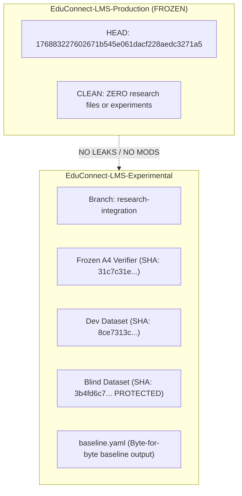
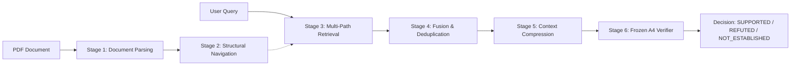

# Research Integration Architecture

**Repository:** `EduConnect-LMS-Experimental`  
**Branch:** `research-integration`  
**Status:** Approved Research-Only Infrastructure  
**Baseline Anchor:** EXP-0040 / C2_085 / A4 (Commit `63d961ee9a94d69c911f785a8b6a7d25cabd18f9`)

---

## 1. Executive Summary & Purpose

The **Research Integration Architecture** provides a modular, reproducible, and strictly isolated infrastructure for evaluating advanced retrieval, document processing, local inference, context compression, and fusion mechanisms. 

### Core Architectural Principle
This is a **reusable research infrastructure build**. Its objective is to absorb integration complexity once so future experiments primarily modify configuration profiles, experimental manifests, and evaluation protocols rather than rewriting repository infrastructure.

---

## 2. Governance & Invariants



1. **Production Isolation:** `EduConnect-LMS-Production` remains untouched at frozen HEAD `176883227602671b545e061dacf228aedc3271a5`. No research code, experiments, or configs may touch or leak into production.
2. **Baseline Invariance:** The frozen `EXP-0040/C2_085/A4` baseline remains byte-for-byte reproducible. When `baseline.yaml` is active, all optional components are disabled and output is identical to the frozen reference.
3. **No Simulations Policy:** Missing dependencies or models report `NOT_READY` or `READY_WITH_LIMITATIONS` with explicit failure reasons, dependencies, and OS requirements. Handcrafted fake metrics or fallback simulations (e.g., substituting SentenceTransformers when PyLate is absent) are strictly forbidden.
4. **No Winner Selection & No Blind Evaluation:** This task is infrastructure integration only. Blind evaluation ($N=500$) is strictly locked and prohibited from execution. Fusion weights are un-tuned (neutral defaults only). `full_stack.yaml` is an integration verification profile only—never default, and never claimed superior.
5. **PageIndex Structural vs Agentic Separation:** PageIndex structural navigation (`pageindex_adapter.py`) and native tool-mediated agentic retrieval (`pageindex_agentic_adapter.py` from EXP-0057) remain two distinct, unmerged adapters.

---

## 3. Pipeline Architecture & Data Flow

The unified execution pipeline processes queries through seven strictly decoupled stages:



### Stage 1: Document Ingestion & Parsing
* **Adapters:** `PythonDoclingAdapter`, `DoclingRsAdapter` (native Rust), `MarkerAdapter`, `SuryaAdapter`.
* **Data Contract:** Emits normalized `PageArtifact` objects containing page numbers, section IDs, headings, text, tables, and figures.
* **Bounded Memory:** Streaming page-window processing ensures $O(1)$ memory consumption for large PDFs.

### Stage 2: Document Navigation
* **Structural Navigator (`pageindex_adapter.py`):** Real PDF-native outline extraction via `pageindex.page_index_flash` to identify bounded page ranges.
* **Agentic Retriever (`pageindex_agentic_adapter.py`):** Tool-mediated multi-turn search using native PageIndex tools (`get_document_structure`, `get_page_content`) and local LLM orchestration (`llama3.2:latest`).

### Stage 3: Multi-Path Retrieval
* **Dense/Sparse Retrieval:** `BGEFlagAdapter` (dense 1024-dim, sparse lexical weights, ColBERT late interaction).
* **Vector Database:** `QdrantAdapter` (hybrid dense + sparse vector search with RRF).
* **Late-Interaction ColBERT:** `PyLateAdapter` (MaxSim token-level scoring via `lightonai/pylate`).
* **Visual Document Retrieval:** `ColSmolAdapter` (multi-vector vision retrieval over rendered page images).
* **Graph Retrieval:** `Neo4jGraphRAGAdapter` (graph traversal and hybrid vector+graph retrieval).
* **Corrective Retrieval:** `CRAGAdapter` (closed-corpus quality evaluation and query reformulation; strictly offline, zero web search).
* **Composite Retrieval:** `RAGLiteAdapter` (isolated storage, late chunking, hybrid retrieval).

### Stage 4: Fusion & Deduplication Layer
* **Engine:** `FusionLayer` (`research/orchestration/fusion.py`).
* **Algorithms:** Reciprocal Rank Fusion (RRF), weighted rank fusion, Min-Max / Sigmoid / Z-score normalization.
* **Grouping:** Hierarchical grouping (child chunks to parent sections), page grouping, section grouping, and deduplication.

### Stage 5: Context Compression
* **Adapter:** `LLMLinguaAdapter` (`research/context_processing/llmlingua_adapter.py`).
* **Position:** Post-retrieval, pre-verifier (`retrieval -> fusion -> compression -> verifier`).
* **Zero Overhead When Disabled:** Passes through text byte-for-byte identically when disabled.

### Stage 6: Frozen A4 NLI Verifier
* **Executable:** `backend/rag_ambiguity_guard_verifier.php` (SHA: `31c7c31ef6301156bb0318cb35ba5879e5ca3c25acdd6f705cd2f6c0e3b0fc2e`).
* **Input:** Evidence chunks formatted into canonical schema with title, heading, content, and similarity.
* **Output:** Deterministic verification decision (`SUPPORTED`, `REFUTED`, `NOT_ESTABLISHED`).

---

## 4. Common Data Contract (`RetrievalResult`)

To prevent third-party framework objects from leaking into experimental logic, all retrieval adapters normalize results into the internal `RetrievalResult` schema:

```json
{
  "doc_id": "curriculum_full.pdf",
  "chunk_id": "C2_SEC_001_002",
  "page_start": 3,
  "page_end": 4,
  "section_id": "SEC_001",
  "score": 0.8924,
  "rank": 1,
  "retrieval_method": "bge_m3_dense",
  "evidence_type": "TEXT",
  "metadata": {
    "source_id": "curriculum_full.pdf",
    "token_count": 142
  }
}
```

### Backward Compatibility Accessors
To maintain full interoperability with the frozen A4 verifier and historical benchmark harnesses, `RetrievalResult` provides legacy properties:
* `id` $\rightarrow$ `chunk_id`
* `title` $\rightarrow$ `metadata.get("title", "")`
* `heading` $\rightarrow$ `metadata.get("heading", "")`
* `content` $\rightarrow$ `metadata.get("content", "")`
* `similarity` $\rightarrow$ `score`
* `fused_score` $\rightarrow$ `score`
* `parent_id` $\rightarrow$ `metadata.get("parent_id", chunk_id)`
* `contributing_children` $\rightarrow$ `metadata.get("contributing_children")`

---

## 5. Non-Core Framework Policy

The following frameworks are explicitly classified as **non-core reference adapters**:
* **LlamaIndex**
* **Haystack**
* **LightRAG**

These frameworks are **never required** for running the baseline or unified research pipeline. They remain isolated reference adapters to ensure that framework churn does not compromise repository stability.
